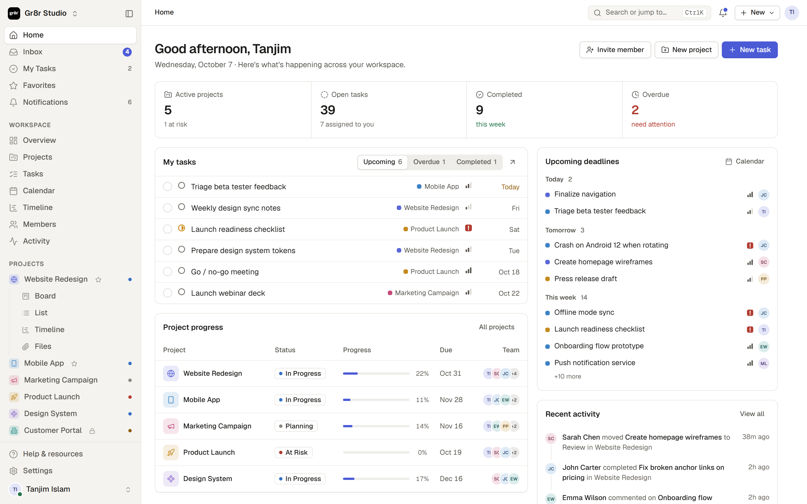

# Gr8r Studio

A calm, structured project management workspace: home dashboard, inbox, my tasks, projects with
board / list / table / calendar / timeline / files views, members, teams, activity and settings.

Built with plain JavaScript ES modules and CSS, bundled by [Vite](https://vite.dev). There is no
UI framework and no runtime dependency.



## Getting started

Requires Node.js 18 or newer (`.nvmrc` pins 22).

```bash
npm install
npm run dev           # Vite + Fastify together (open http://localhost:5173)
npm run dev:web       # frontend only
npm run dev:server    # Fastify API only on :4000 (loads .env)
npm start             # production Fastify server (serves dist/)
npm run build         # production build in dist/
npm run preview       # serve the production build with Vite
npm run lint          # ESLint
npm run format        # Prettier
npm run db:migrate    # apply database migrations
npm run db:seed       # import demo data into DATABASE_URL
npm run db:seed:reset # replace existing data with a fresh seed
```

Self-hosted deployments read the database connection from `DATABASE_URL` only. The first-run
wizard tests that connection, creates the schema, creates the owner account, and optionally
imports demo data. It never asks for or stores database credentials.
See [docs/api.md](docs/api.md#running-self-hosted).

## Project structure

```
index.html              HTML entry; loads src/main.js
public/favicon.svg      brand mark
vite.config.js          Vite config, including the Lucide icon-subset plugin
eslint.config.js        lint rules (ESLint flat config); formatting by Prettier (.prettierrc.json)
.github/workflows/      CI: lint, format check, build
docs/preview.png        README screenshot
server/                 Fastify server, PostgreSQL pool, migrations, setup API
database/               baseline schema and SQL migrations
scripts/                seed and migration CLI scripts
src/
  main.js               entry: imports styles and modules, then boots the app
  styles/
    index.css           imports every stylesheet in cascade order
    tokens.css          colours, spacing, type, radius, the shared --gutter
    base.css  components.css  shell.css  panels.css  overlays.css  states.css  motion.css  responsive.css
    views/              list, board, table, calendar, timeline, projects & files
    pages/              settings, auth & onboarding
  core/                 utilities, constants, icons, store (state + lookups), theme
  api/                  REST-style API: client, routes, repositories (file / future DB)
  data/seed.js          demo workspace fixture served by the file repository
  ui/                   shared render helpers, toasts, the select dropdown
  shell/                render loop and router, sidebar/topbar layout, skeletons, view engine
  components/           task list renderer
  pages/                one module per route
  views/                project views: board, table, calendar, timeline, files, overview
  overlays/             task drawer, modals, popovers, context menu, command palette
  features/             teams, subtasks, archive (rendering)
  actions/              user actions, event wiring, keyboard shortcuts, drag and drop
```

### Layers

Dependencies point downward:

1. `core/` and `data/` depend on nothing else in the app. `api/` depends only on `core/` and `data/`.
2. The store loads the workspace through the API (`api.bootstrap()`) and persists edits through
   `api.saveDocument()`. The app still reads from the synchronous `S.data` cache while rendering.
3. `ui/`, `shell/`, `components/`, `pages/`, `views/`, `overlays/` and `features/` render HTML from state.
4. `actions/` change state and re-render. Each action module registers its handlers on the
   shared action table (`A`) when it loads, so `main.js` imports them after `actions/actions.js`.

### API and server

The browser demo in `src/api/` runs in-process against `repository/file-repository.js`, which
serves `data/seed.js` and persists to `localStorage`.

Self-hosted deployments use `server/` (Fastify + PostgreSQL). On first load, the UI asks
`GET /api/setup/status`. If setup is incomplete it shows the wizard in `src/pages/setup.js`,
which tests the database, creates the schema, creates the owner account, and optionally imports
demo data. The setup API locks after completion.

After setup, login and open registration use Argon2id passwords and HTTP-only cookie sessions.
`GET /api/bootstrap` supplies the authenticated workspace snapshot to the existing synchronous
store. UI edits are persisted with `PUT /api/workspace`, a revision-checked full-workspace sync
covering projects, tasks, comments, teams, members, settings, views, files metadata, and
notifications. Workspace roles and database RLS protect writes and isolate private projects.
See [docs/api.md](docs/api.md).

## Conventions

- **Rendering:** each page or view is a function that returns an HTML string from the store
  (`S`). `render()` rebuilds the shell and keeps focus and scroll positions.
- **Interactions:** elements declare `data-a="actionName"`. `actions/events.js` delegates the
  click to `A.actionName`. Inputs use `data-in`, blur handlers use `data-blur`.
- **Layout:** every page edge uses `var(--gutter)`, so the breadcrumb, page header, toolbar,
  list, table and board start on the same line.
- **Dropdowns:** write a normal `<select class="select">`. `ui/select.js` renders it as the
  design-system menu and keeps the native element as the source of truth.
- **Icons:** call `ic('name')` with any [Lucide](https://lucide.dev) icon name. The
  `virtual:icons` plugin bundles only the icons the source uses.

## Continuous integration

Every push and pull request runs lint, the format check and a production build
(`.github/workflows/ci.yml`).

## Deploy

`vercel.json` builds with Vite and serves `dist/`.
